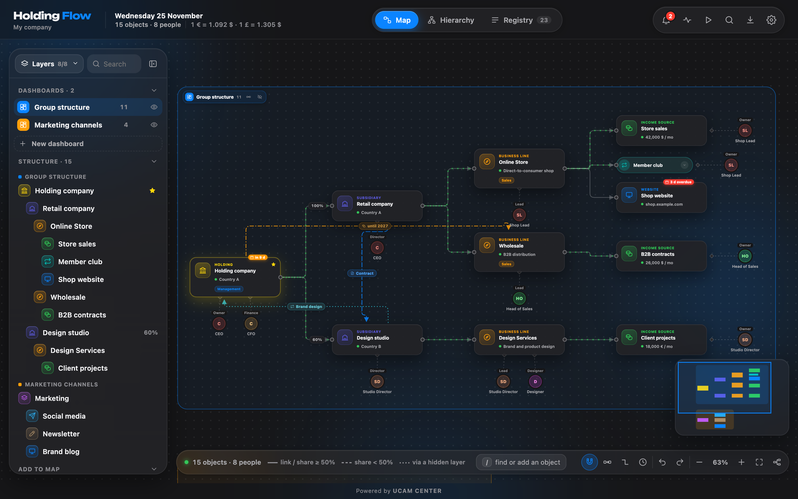
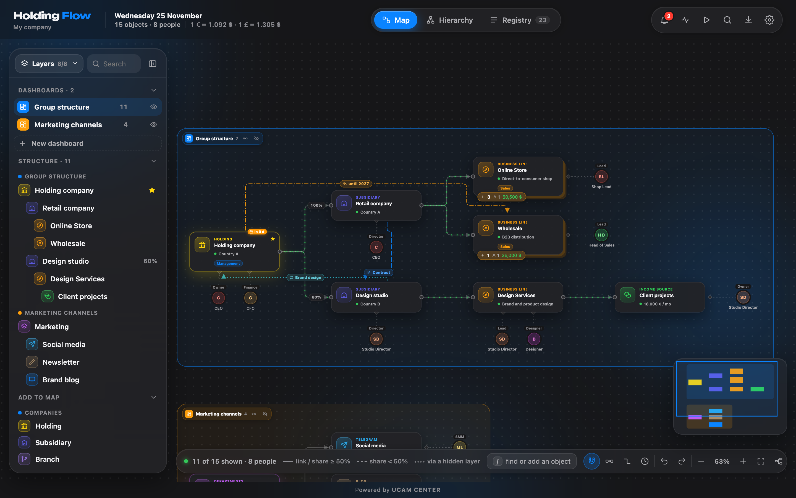
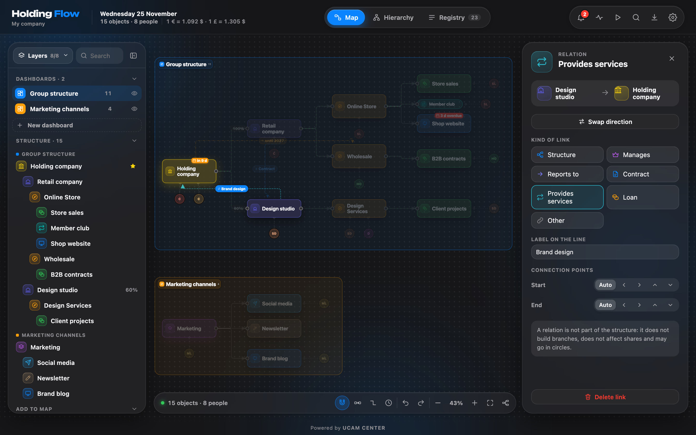
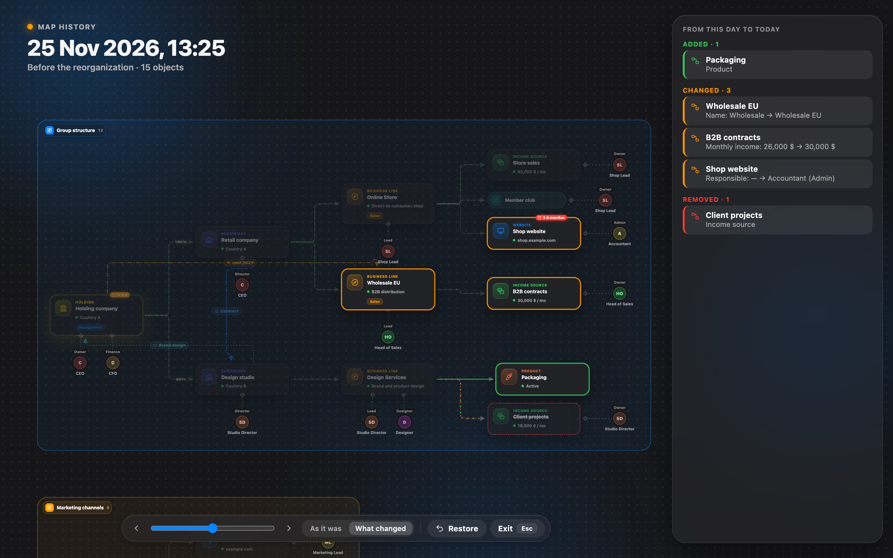
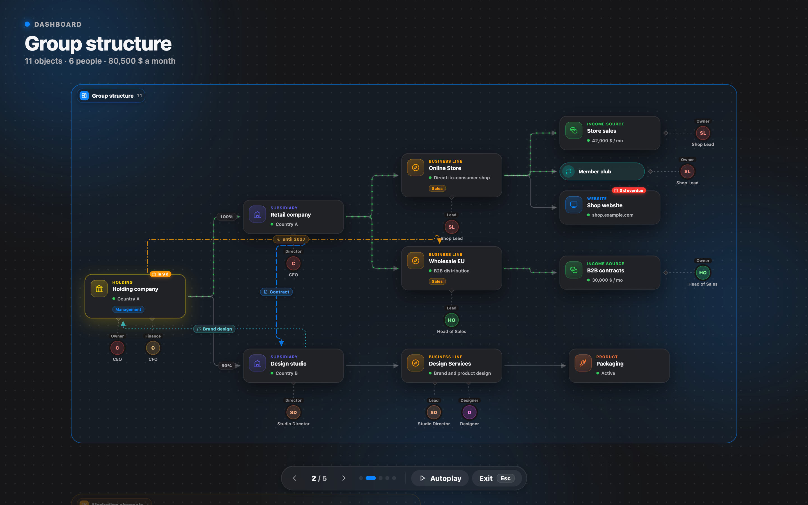
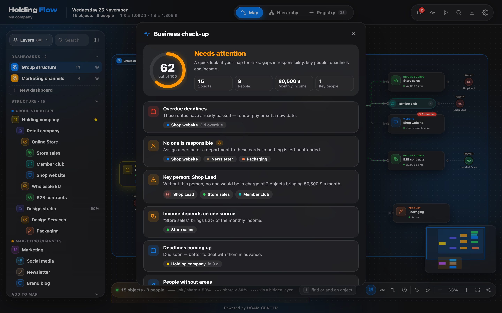
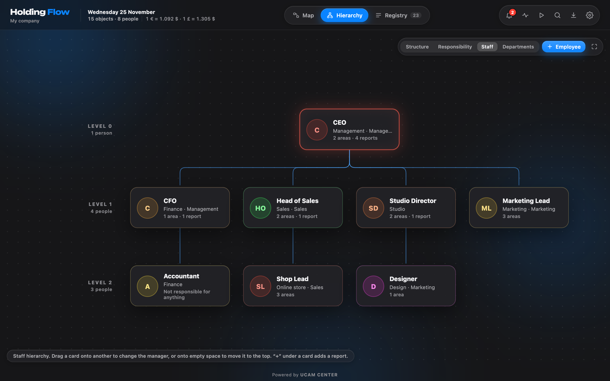

<div align="center">


# Holding Flow

**Un mapa de tu negocio: quién está dónde y de qué se encarga.**<br>
App de escritorio gratuita para macOS y Windows. Tus datos nunca salen de tu ordenador.

<a href="https://github.com/ucamcenter/holding-flow-releases/releases/latest"></a> <a href="https://github.com/ucamcenter/holding-flow-releases/releases"></a> <a href="https://github.com/ucamcenter/holding-flow-releases/stargazers"></a>  <a href="https://github.com/ucamcenter/holding-flow-releases/watchers"></a>

  

<br>

<a href="https://github.com/ucamcenter/holding-flow-releases/releases/download/v1.2.0/HoldingFlow-1.2.0-mac.dmg"></a>&nbsp;<a href="https://github.com/ucamcenter/holding-flow-releases/releases/download/v1.2.0/HoldingFlow-1.2.0-windows-setup.exe"></a>

<sub><a href="https://github.com/ucamcenter/holding-flow-releases/releases">Todas las versiones y notas</a></sub>

<br>

<a href="README.md">English</a> · <b>Español</b> · <a href="README.ro.md">Română</a> · <a href="README.ru.md">Русский</a>

</div>

<br>

<p align="center"></p>
<p align="center"><sub>El mapa de la estructura: tableros, responsables, relaciones, flujo de dinero y minimapa</sub></p>

Holding Flow reúne todo el negocio en un solo lienzo: holdings y empresas, líneas de negocio y productos, fuentes de ingresos y canales de venta, equipos, departamentos, sitios web y canales, y las personas responsables de cada uno. Pensado para dueños de pequeñas y medianas empresas que llevan la estructura en la cabeza y quieren por fin verla.

## ✨ Novedades de la 1.2.0

- **Contraer ramas** — «−» en una tarjeta oculta todo lo que hay debajo y muestra cuántas tarjetas, personas e ingresos contiene. <kbd>E</kbd>: una rama; <kbd>⇧E</kbd>: todo el mapa.
- **Legible de lejos** — Al alejar, las tarjetas se convierten en placas grandes con el nombre; el minimapa muestra dónde estás.
- **Relaciones** — Dirige, depende de, contrato, servicios, préstamo y tu propio texto: fuera de la estructura, incluso en círculo.
- **Líneas en ángulo recto** — Los vínculos rodean las tarjetas en lugar de cruzarlas (las curvas están a un clic).
- **Historial del mapa** — Copias diarias y de seguridad: «como era», «qué cambió», restaurar. Pulsa <kbd>T</kbd>.
- **Departamentos en el mapa** — Un departamento y su tarjeta ahora son lo mismo, con las mismas personas y el mismo jefe.
- **Telegram automático** — Los avisos de plazos y el resumen semanal se envían mientras la app está abierta.

## 🧩 Funciones

<table>
<tr><td width="33%" valign="top">🗺️ <b>Mapa</b><br><sub>Tarjetas y vínculos, participaciones, ramas que se contraen, minimapa y responsables junto a cada tarjeta</sub></td><td width="33%" valign="top">🔗 <b>Relaciones</b><br><sub>Contratos, servicios, préstamos y gestión por encima de la estructura, cada tipo con su estilo</sub></td><td width="33%" valign="top">🕰️ <b>Historial del mapa</b><br><sub>Copias diarias, comparación con hoy y restauración en un clic</sub></td></tr>
<tr><td width="33%" valign="top">🧭 <b>Tableros</b><br><sub>Varias zonas con nombre en un mismo mapa: red de empresas, personas, flujos de dinero</sub></td><td width="33%" valign="top">🏢 <b>Departamentos y listas propias</b><br><sub>Asigna personas, vincula departamentos a proyectos; oficinas, regiones, turnos: cualquier lista</sub></td><td width="33%" valign="top">🌳 <b>Jerarquía</b><br><sub>Estructura, responsabilidad, organigrama editable y vista por departamentos</sub></td></tr>
<tr><td width="33%" valign="top">📋 <b>Registro</b><br><sub>Todos los objetos y personas en una lista, con ingresos mensuales, plazos y huecos</sub></td><td width="33%" valign="top">💱 <b>25 monedas</b><br><sub>Tipos de cambio diarios para cualquier par; totales en tu moneda principal</sub></td><td width="33%" valign="top">⏰ <b>Plazos</b><br><sub>Renovación de dominios, informes, pagos: avisos en la app y en Telegram</sub></td></tr>
<tr><td width="33%" valign="top">📄 <b>PDF y JSON</b><br><sub>Exporta el mapa, las jerarquías y los registros; copia completa e importación</sub></td><td width="33%" valign="top">🌍 <b>5 idiomas</b><br><sub>English · Español · Română · Русский · Українська; temas oscuro y claro</sub></td></tr>
</table>

## 🖼️ Capturas

<table>
<tr><td width="50%" valign="top"><p align="center"><sub><b>Ramas contraídas: lo de dentro sigue a la vista</b></sub></p></td><td width="50%" valign="top"><p align="center"><sub><b>Relaciones: contrato, servicios, préstamo…</b></sub></p></td></tr>
<tr><td width="50%" valign="top"><p align="center"><sub><b>Historial del mapa: qué cambió</b></sub></p></td><td width="50%" valign="top"><p align="center"><sub><b>Modo presentación</b></sub></p></td></tr>
<tr><td width="50%" valign="top"><p align="center"><sub><b>Chequeo del negocio</b></sub></p></td><td width="50%" valign="top"><p align="center"><sub><b>Jerarquía del personal</b></sub></p></td></tr>
</table>

## ⬇️ Descarga e instalación

| Sistema | Archivo |
|---|---|
| macOS (Apple Silicon e Intel) | [`HoldingFlow-1.2.0-mac.dmg`](https://github.com/ucamcenter/holding-flow-releases/releases/download/v1.2.0/HoldingFlow-1.2.0-mac.dmg) |
| Windows 10/11 (64 bits) | [`HoldingFlow-1.2.0-windows-setup.exe`](https://github.com/ucamcenter/holding-flow-releases/releases/download/v1.2.0/HoldingFlow-1.2.0-windows-setup.exe) |

### Primer inicio

Los instaladores aún no están firmados con certificados de pago de Apple/Microsoft, así que el sistema pide permiso una vez:

- **macOS:** clic derecho en la app → **Abrir** → **Abrir**. O Ajustes del Sistema → Privacidad y seguridad → **Abrir igualmente**. O en Terminal:
  ```bash
  xattr -dr com.apple.quarantine "/Applications/Holding Flow.app"
  ```
- **Windows:** en la ventana «Windows protegió su PC» pulsa **Más información → Ejecutar de todas formas**.

El mapa empieza vacío: crea el primer objeto con los botones del centro de la pantalla o pulsa <kbd>/</kbd>. La guía completa está dentro de la app: Ajustes → Acerca de → **Abrir la guía**. Ahí también se buscan nuevas versiones.

## 🔒 Privacidad

Sin cuenta, sin nube, sin rastreo. Todo lo que pones en el mapa se guarda solo en tu ordenador. Internet solo se usa para los tipos de cambio y la búsqueda de actualizaciones.

## 💬 Contacto

<p><a href="https://ucam-center.com/es/programs/"></a> <a href="mailto:support@ucam-center.com"></a> <a href="https://www.behance.net/ucamcenter"></a> <a href="https://github.com/ucamcenter"></a></p>

---

<div align="center">

Holding Flow es gratis y sigue recibiendo actualizaciones.

<sub>Powered by <a href="https://ucam-center.com/es/programs/"><b>UCAM CENTER</b></a></sub>

</div>
