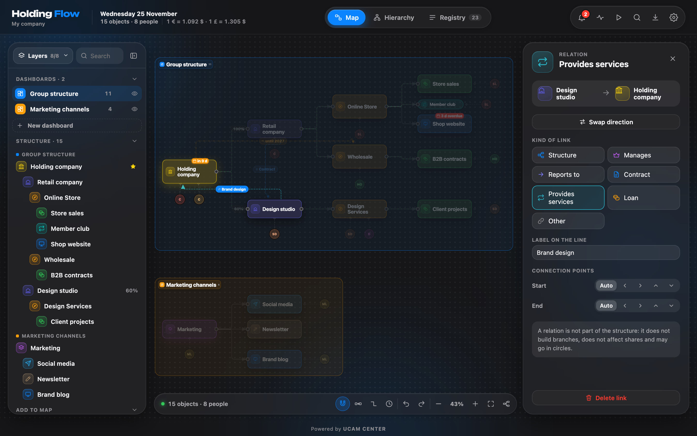
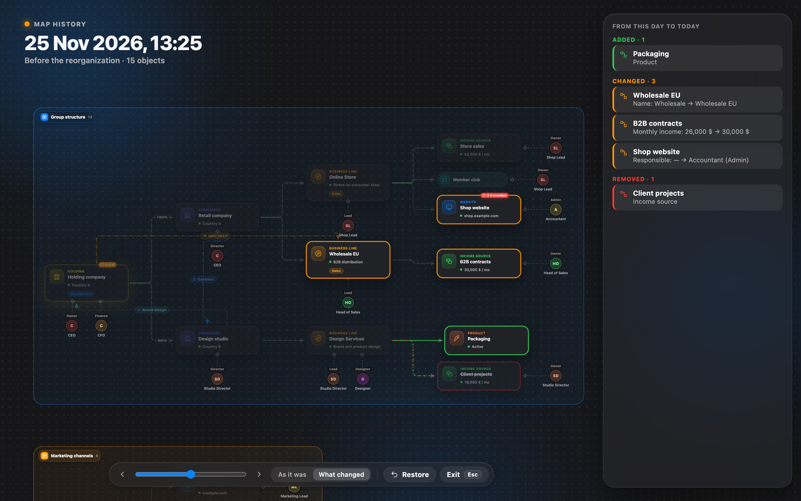
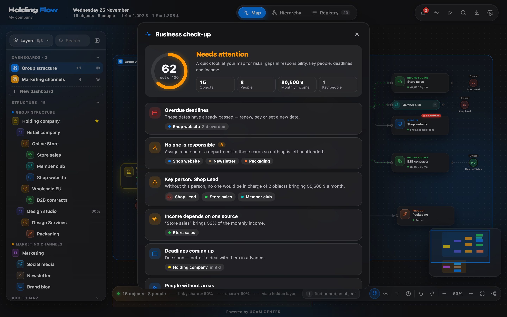

<div align="center">


# Holding Flow

**A map of your business: who is where and responsible for what.**<br>
Free desktop app for macOS and Windows. Your data never leaves your computer.

<a href="https://github.com/ucamcenter/holding-flow-releases/releases/latest"></a> <a href="https://github.com/ucamcenter/holding-flow-releases/releases"></a> <a href="https://github.com/ucamcenter/holding-flow-releases/stargazers"></a>  <a href="https://github.com/ucamcenter/holding-flow-releases/watchers"></a>

  

<br>

<a href="https://github.com/ucamcenter/holding-flow-releases/releases/download/v1.2.0/HoldingFlow-1.2.0-mac.dmg"></a>&nbsp;<a href="https://github.com/ucamcenter/holding-flow-releases/releases/download/v1.2.0/HoldingFlow-1.2.0-windows-setup.exe"></a>

<sub><a href="https://github.com/ucamcenter/holding-flow-releases/releases">All versions and release notes</a></sub>

<br>

<b>English</b> · <a href="README.es.md">Español</a> · <a href="README.ro.md">Română</a> · <a href="README.ru.md">Русский</a>

</div>

<br>

<p align="center"></p>
<p align="center"><sub>The structure map: dashboards, responsible people, relations, money flow and the minimap</sub></p>

Holding Flow puts the whole business on one canvas: holdings and companies, business lines and products, income sources and sales channels, teams, departments, websites and channels — and the people responsible for each of them. Built for owners of small and mid-sized businesses who keep the structure in their heads and want to finally see it.

## ✨ What’s new in 1.2.0

- **Collapse branches** — “−” on a card hides everything below it and shows how many cards, people and how much income are inside. <kbd>E</kbd> — one branch, <kbd>⇧E</kbd> — the whole map.
- **Readable from afar** — Zoomed out, cards turn into large plates with a name; a minimap shows where you are.
- **Relations** — Manages, reports to, contract, services, loan and your own label — outside the structure, in circles if needed.
- **Right-angled lines** — Links go around cards instead of crossing them (curves are one click away).
- **Map history** — Daily snapshots and safety copies: “as it was”, “what changed”, restore. Press <kbd>T</kbd>.
- **Departments on the map** — A department and its card are now one thing, with the same people and head.
- **Telegram by itself** — Deadline reminders and a weekly summary are sent while the app is open.

## 🧩 Features

<table>
<tr><td width="33%" valign="top">🗺️ <b>Map</b><br><sub>Cards and links, ownership shares, collapsible branches, minimap, responsible people next to every card</sub></td><td width="33%" valign="top">🔗 <b>Relations</b><br><sub>Contracts, services, loans and management links on top of the structure, each kind in its own style</sub></td><td width="33%" valign="top">🕰️ <b>Map history</b><br><sub>Daily snapshots, comparison with today, restore in one click</sub></td></tr>
<tr><td width="33%" valign="top">🧭 <b>Dashboards</b><br><sub>Several named areas on one map — the company network, people, money flows</sub></td><td width="33%" valign="top">🏢 <b>Departments and your own lists</b><br><sub>Assign people, attach departments to projects; offices, regions, shifts — any list you need</sub></td><td width="33%" valign="top">🌳 <b>Hierarchy</b><br><sub>Structure, responsibility, an editable staff chart and a view by department</sub></td></tr>
<tr><td width="33%" valign="top">📋 <b>Registry</b><br><sub>Every object and person in a list, with monthly income, deadlines and gaps</sub></td><td width="33%" valign="top">💱 <b>25 currencies</b><br><sub>Daily exchange rates for any pair; totals converted into your main currency</sub></td><td width="33%" valign="top">⏰ <b>Deadlines</b><br><sub>Domain renewals, reports, payments — reminders in the app and in Telegram</sub></td></tr>
<tr><td width="33%" valign="top">📄 <b>PDF and JSON</b><br><sub>Export the map, hierarchies and registries; full backup and import</sub></td><td width="33%" valign="top">🌍 <b>5 languages</b><br><sub>English · Español · Română · Русский · Українська; dark and light themes</sub></td></tr>
</table>

## 🖼️ Screenshots

<table>
<tr><td width="50%" valign="top"><p align="center"><sub><b>Collapsed branches: what is inside is still visible</b></sub></p></td><td width="50%" valign="top"><p align="center"><sub><b>Relations: contract, services, loan…</b></sub></p></td></tr>
<tr><td width="50%" valign="top"><p align="center"><sub><b>Map history: what changed</b></sub></p></td><td width="50%" valign="top"><p align="center"><sub><b>Presentation mode</b></sub></p></td></tr>
<tr><td width="50%" valign="top"><p align="center"><sub><b>Business check-up</b></sub></p></td><td width="50%" valign="top"><p align="center"><sub><b>Staff hierarchy</b></sub></p></td></tr>
</table>

## ⬇️ Download and install

| System | File |
|---|---|
| macOS (Apple Silicon & Intel) | [`HoldingFlow-1.2.0-mac.dmg`](https://github.com/ucamcenter/holding-flow-releases/releases/download/v1.2.0/HoldingFlow-1.2.0-mac.dmg) |
| Windows 10/11 (64-bit) | [`HoldingFlow-1.2.0-windows-setup.exe`](https://github.com/ucamcenter/holding-flow-releases/releases/download/v1.2.0/HoldingFlow-1.2.0-windows-setup.exe) |

### First launch

The installers are not signed with paid Apple/Microsoft certificates yet, so the system asks for permission once:

- **macOS:** right-click the app → **Open** → **Open**. Or System Settings → Privacy & Security → **Open Anyway**. Or run in Terminal:
  ```bash
  xattr -dr com.apple.quarantine "/Applications/Holding Flow.app"
  ```
- **Windows:** in the “Windows protected your PC” window click **More info → Run anyway**.

The map starts empty: create the first object with the buttons in the middle of the screen, or press <kbd>/</kbd>. The full user guide is inside the app: Settings → About → **Open guide**. The app checks for new versions there too.

## 🔒 Privacy

No account, no cloud, no tracking. Everything you put on the map is stored only on your computer. The internet is used only for exchange rates and the update check.

## 💬 Contacts

<p><a href="https://ucam-center.com/programs/"></a> <a href="mailto:support@ucam-center.com"></a> <a href="https://www.behance.net/ucamcenter"></a> <a href="https://github.com/ucamcenter"></a></p>

---

<div align="center">

Holding Flow is free and keeps getting updates.

<sub>Powered by <a href="https://ucam-center.com/programs/"><b>UCAM CENTER</b></a></sub>

</div>
