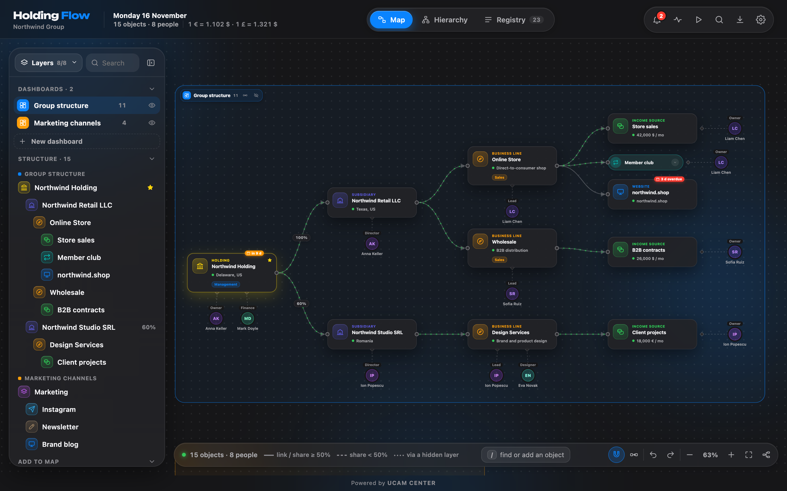
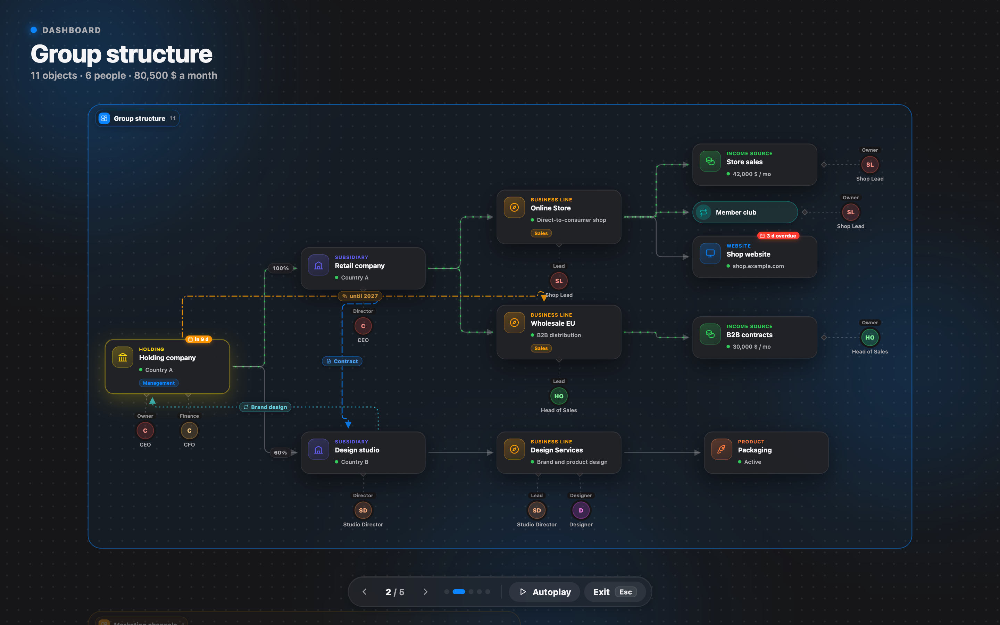
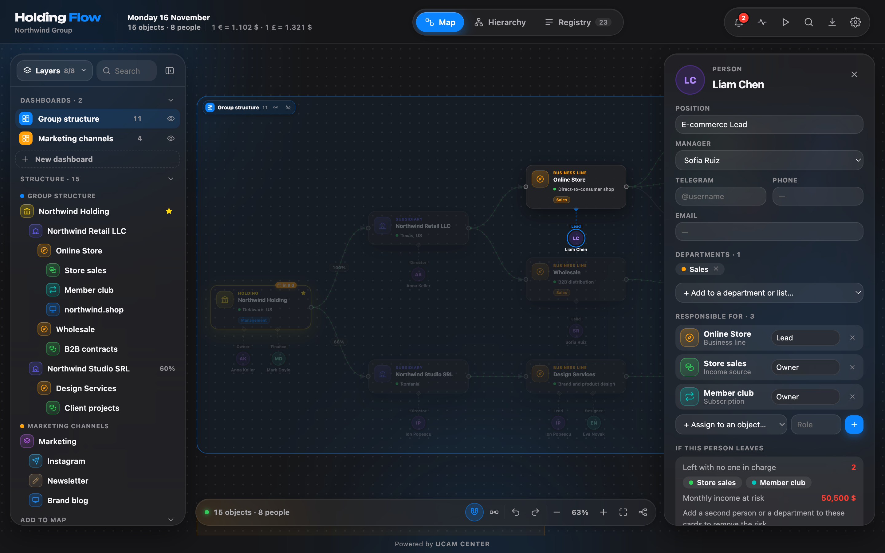
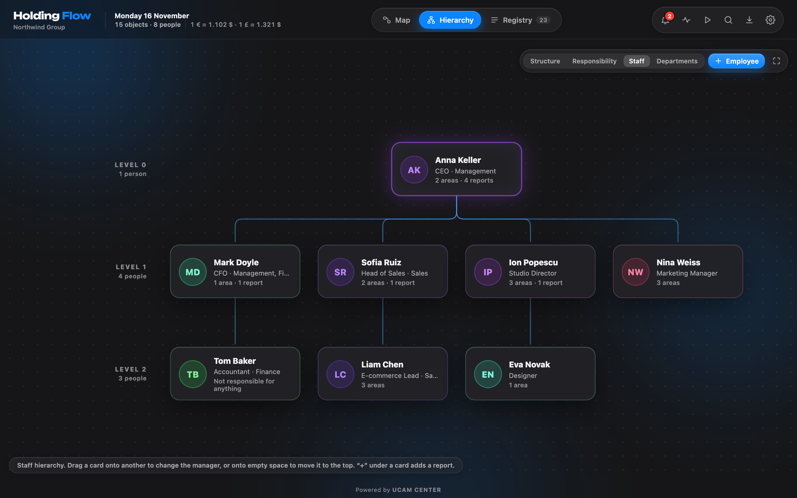
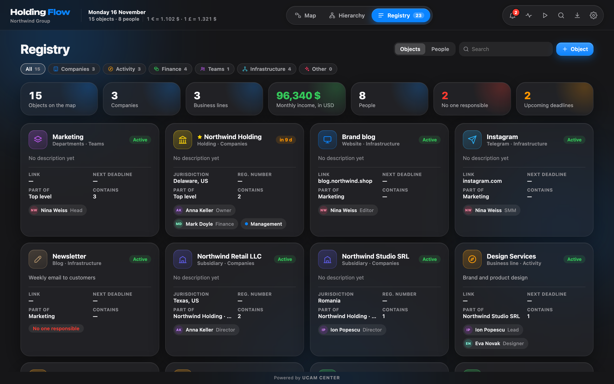

<div align="center">


# Holding Flow

**A map of your business: who is where and responsible for what.**<br>
Free desktop app for macOS and Windows. Your data never leaves your computer.

<a href="https://github.com/ucamcenter/holding-flow-releases/releases/latest"></a> <a href="https://github.com/ucamcenter/holding-flow-releases/releases"></a> <a href="https://github.com/ucamcenter/holding-flow-releases/stargazers"></a>  <a href="https://github.com/ucamcenter/holding-flow-releases/watchers"></a>

  

<br>

<a href="https://github.com/ucamcenter/holding-flow-releases/releases/download/v1.1.0/HoldingFlow-1.1.0-mac.dmg"></a>&nbsp;<a href="https://github.com/ucamcenter/holding-flow-releases/releases/download/v1.1.0/HoldingFlow-1.1.0-windows-setup.exe"></a>

<sub><a href="https://github.com/ucamcenter/holding-flow-releases/releases">All versions and release notes</a></sub>

<br>

<b>English</b> · <a href="README.es.md">Español</a> · <a href="README.ro.md">Română</a> · <a href="README.ru.md">Русский</a>

</div>

<br>

<p align="center"></p>
<p align="center"><sub>The map with dashboards, responsible people and money flow</sub></p>

Holding Flow puts the whole business on one canvas: holdings and companies, business lines and products, income sources and sales channels, teams, departments, websites and channels — and the people responsible for each of them. Built for owners of small and mid-sized businesses who keep the structure in their heads and want to finally see it.

## ✨ What’s new in 1.1.0

- **Presentation mode** — A full-screen tour of your map for partners, investors or the team: the whole map, every dashboard and its main branches, with smooth zoom, autoplay and arrow keys. Press <kbd>P</kbd>.
- **Business check-up** — A score out of 100 and a list of risks: cards with no one responsible, key people, overdue deadlines, dependence on one income source, departments without people or a head. Press <kbd>C</kbd>.
- **“If this person leaves”** — Every person’s card shows what would be left with no one in charge and how much monthly income is at risk.
- **Money flow** — Income runs along the links on the map — faster where there is more money.

## 🧩 Features

<table>
<tr><td width="33%" valign="top">🗺️ <b>Map</b><br><sub>Cards and links, ownership shares between companies, responsible people next to every card</sub></td><td width="33%" valign="top">🧭 <b>Dashboards</b><br><sub>Several named areas on one map — the company network, people, money flows</sub></td><td width="33%" valign="top">🏢 <b>Departments and your own lists</b><br><sub>Assign people, attach departments to projects; offices, regions, shifts — any list you need</sub></td></tr>
<tr><td width="33%" valign="top">🌳 <b>Hierarchy</b><br><sub>Structure, responsibility, an editable staff chart and a view by department</sub></td><td width="33%" valign="top">📋 <b>Registry</b><br><sub>Every object and person in a list, with monthly income, deadlines and gaps</sub></td><td width="33%" valign="top">💱 <b>25 currencies</b><br><sub>Daily exchange rates for any pair; totals converted into your main currency</sub></td></tr>
<tr><td width="33%" valign="top">⏰ <b>Deadlines</b><br><sub>Domain renewals, reports, payments — reminders in the app and in Telegram</sub></td><td width="33%" valign="top">📄 <b>PDF and JSON</b><br><sub>Export the map, hierarchies and registries; full backup and import</sub></td><td width="33%" valign="top">🌍 <b>5 languages</b><br><sub>English · Español · Română · Русский · Українська; dark and light themes</sub></td></tr>
</table>

## 🖼️ Screenshots

<table>
<tr><td width="50%" valign="top"><p align="center"><sub><b>Presentation mode</b></sub></p></td><td width="50%" valign="top"><p align="center"><sub><b>Business check-up</b></sub></p></td></tr>
<tr><td width="50%" valign="top"><p align="center"><sub><b>If this person leaves</b></sub></p></td><td width="50%" valign="top"><p align="center"><sub><b>Staff hierarchy</b></sub></p></td></tr>
</table>

<p align="center"><br><sub><b>Registry</b></sub></p>

## ⬇️ Download and install

| System | File |
|---|---|
| macOS (Apple Silicon & Intel) | [`HoldingFlow-1.1.0-mac.dmg`](https://github.com/ucamcenter/holding-flow-releases/releases/download/v1.1.0/HoldingFlow-1.1.0-mac.dmg) |
| Windows 10/11 (64-bit) | [`HoldingFlow-1.1.0-windows-setup.exe`](https://github.com/ucamcenter/holding-flow-releases/releases/download/v1.1.0/HoldingFlow-1.1.0-windows-setup.exe) |

### First launch

The installers are not signed with paid Apple/Microsoft certificates yet, so the system asks for permission once:

- **macOS:** right-click the app → **Open** → **Open**. Or System Settings → Privacy & Security → **Open Anyway**. Or run in Terminal:
  ```bash
  xattr -dr com.apple.quarantine "/Applications/Holding Flow.app"
  ```
- **Windows:** in the “Windows protected your PC” window click **More info → Run anyway**.

The map starts empty: create the first object with the buttons in the middle of the screen, or press <kbd>/</kbd>. The full user guide is inside the app: Settings → About → **Open guide**. The app checks for new versions there too.

## 🔒 Privacy

No account, no cloud, no tracking. Everything you put on the map is stored only on your computer. The internet is used only for exchange rates and the update check.

## 💬 Contacts

<p><a href="https://ucam-center.com/programs/"></a> <a href="mailto:support@ucam-center.com"></a> <a href="https://www.behance.net/ucamcenter"></a> <a href="https://github.com/ucamcenter"></a></p>

---

<div align="center">

Holding Flow is free and keeps getting updates.

<sub>Powered by <a href="https://ucam-center.com/programs/"><b>UCAM CENTER</b></a></sub>

</div>
