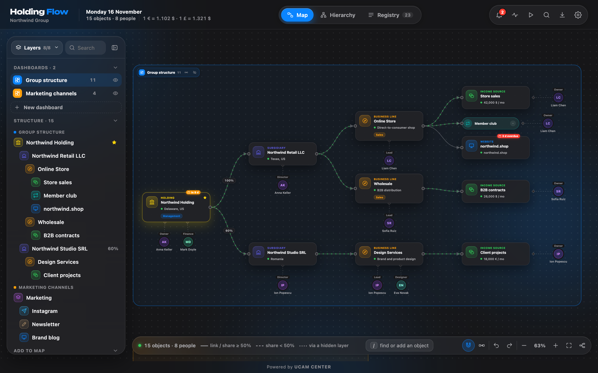
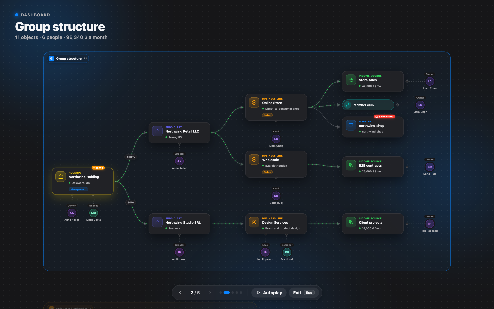
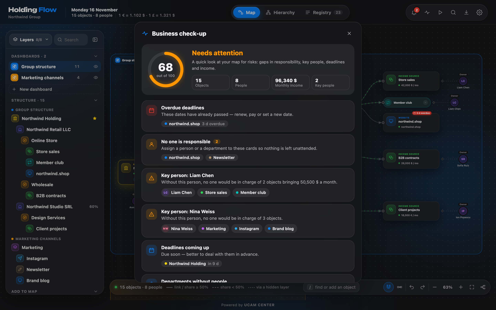
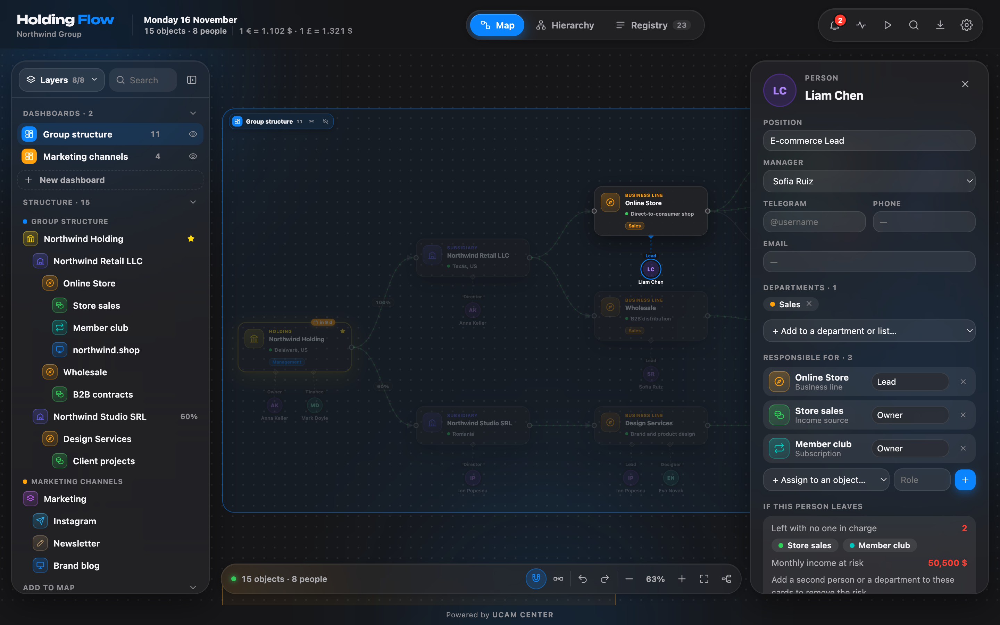
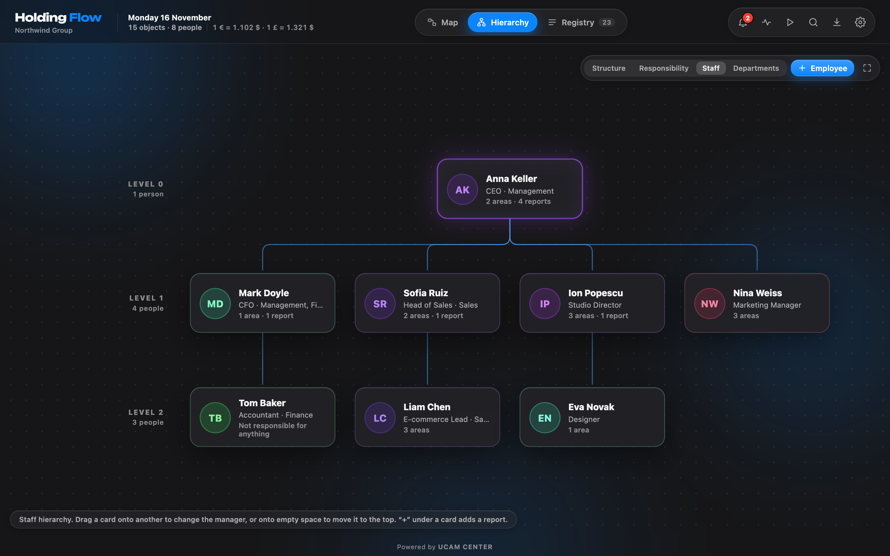
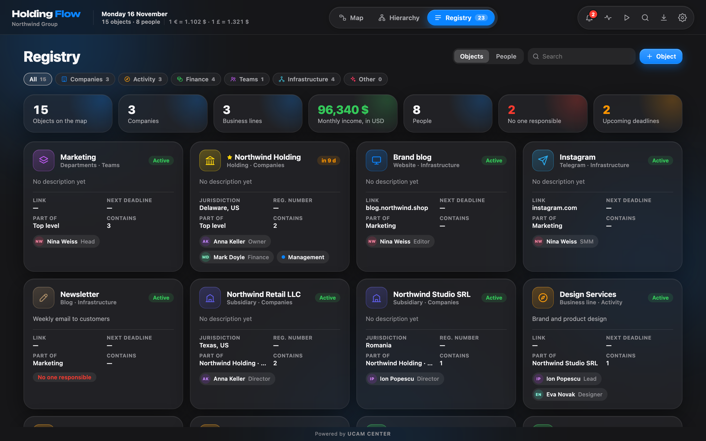

<div align="center">


# Holding Flow

**O hartă a afacerii tale: cine unde este și de ce răspunde.**<br>
Aplicație desktop gratuită pentru macOS și Windows. Datele tale nu părăsesc niciodată calculatorul.

<a href="https://github.com/ucamcenter/holding-flow-releases/releases/latest"></a> <a href="https://github.com/ucamcenter/holding-flow-releases/releases"></a> <a href="https://github.com/ucamcenter/holding-flow-releases/stargazers"></a>  <a href="https://github.com/ucamcenter/holding-flow-releases/watchers"></a>

  

<br>

<a href="https://github.com/ucamcenter/holding-flow-releases/releases/download/v1.1.0/HoldingFlow-1.1.0-mac.dmg"></a>&nbsp;<a href="https://github.com/ucamcenter/holding-flow-releases/releases/download/v1.1.0/HoldingFlow-1.1.0-windows-setup.exe"></a>

<sub><a href="https://github.com/ucamcenter/holding-flow-releases/releases">Toate versiunile și notele de lansare</a></sub>

<br>

<a href="README.md">English</a> · <a href="README.es.md">Español</a> · <b>Română</b> · <a href="README.ru.md">Русский</a>

</div>

<br>

<p align="center"></p>
<p align="center"><sub>Harta cu tablouri de bord, responsabili și fluxul de bani</sub></p>

Holding Flow adună toată afacerea pe o singură pânză: holdinguri și companii, direcții și produse, surse de venit și canale de vânzare, echipe, departamente, site-uri și canale — și oamenii responsabili de fiecare. Gândită pentru proprietarii de afaceri mici și mijlocii care țin structura în cap și vor, în sfârșit, s-o vadă.

## ✨ Ce e nou în 1.1.0

- **Modul prezentare** — Un tur pe tot ecranul prin hartă pentru parteneri, investitori sau echipă: toată harta, fiecare tablou de bord și ramurile lui principale, cu zoom lin, redare automată și săgeți. Apasă <kbd>P</kbd>.
- **Verificarea afacerii** — O notă din 100 și o listă de riscuri: carduri fără responsabil, oameni-cheie, termene depășite, dependența de o singură sursă de venit, departamente fără oameni sau fără șef. Apasă <kbd>C</kbd>.
- **„Dacă această persoană pleacă”** — Fișa fiecărei persoane arată ce ar rămâne fără responsabil și cât venit lunar e în pericol.
- **Fluxul de bani** — Venitul curge pe legăturile hărții — mai repede acolo unde sunt mai mulți bani.

## 🧩 Funcții

<table>
<tr><td width="33%" valign="top">🗺️ <b>Hartă</b><br><sub>Carduri și legături, cote de participație între companii, responsabili lângă fiecare card</sub></td><td width="33%" valign="top">🧭 <b>Tablouri de bord</b><br><sub>Mai multe zone cu nume pe aceeași hartă: rețeaua de companii, oameni, fluxuri de bani</sub></td><td width="33%" valign="top">🏢 <b>Departamente și liste proprii</b><br><sub>Adaugă oameni, atașează departamente la proiecte; birouri, regiuni, ture — orice listă</sub></td></tr>
<tr><td width="33%" valign="top">🌳 <b>Ierarhie</b><br><sub>Structură, responsabilitate, organigramă editabilă și vedere pe departamente</sub></td><td width="33%" valign="top">📋 <b>Registru</b><br><sub>Toate obiectele și persoanele într-o listă, cu venit lunar, termene și goluri</sub></td><td width="33%" valign="top">💱 <b>25 de valute</b><br><sub>Cursuri zilnice pentru orice pereche; totaluri în moneda ta principală</sub></td></tr>
<tr><td width="33%" valign="top">⏰ <b>Termene</b><br><sub>Reînnoirea domeniilor, rapoarte, plăți — memento-uri în aplicație și în Telegram</sub></td><td width="33%" valign="top">📄 <b>PDF și JSON</b><br><sub>Exportă harta, ierarhiile și registrele; copie completă și import</sub></td><td width="33%" valign="top">🌍 <b>5 limbi</b><br><sub>English · Español · Română · Русский · Українська; teme întunecată și luminoasă</sub></td></tr>
</table>

## 🖼️ Capturi de ecran

<table>
<tr><td width="50%" valign="top"><p align="center"><sub><b>Modul prezentare</b></sub></p></td><td width="50%" valign="top"><p align="center"><sub><b>Verificarea afacerii</b></sub></p></td></tr>
<tr><td width="50%" valign="top"><p align="center"><sub><b>Dacă această persoană pleacă</b></sub></p></td><td width="50%" valign="top"><p align="center"><sub><b>Ierarhia personalului</b></sub></p></td></tr>
</table>

<p align="center"><br><sub><b>Registru</b></sub></p>

## ⬇️ Descărcare și instalare

| Sistem | Fișier |
|---|---|
| macOS (Apple Silicon și Intel) | [`HoldingFlow-1.1.0-mac.dmg`](https://github.com/ucamcenter/holding-flow-releases/releases/download/v1.1.0/HoldingFlow-1.1.0-mac.dmg) |
| Windows 10/11 (64 de biți) | [`HoldingFlow-1.1.0-windows-setup.exe`](https://github.com/ucamcenter/holding-flow-releases/releases/download/v1.1.0/HoldingFlow-1.1.0-windows-setup.exe) |

### Prima pornire

Instalatoarele nu sunt încă semnate cu certificate plătite Apple/Microsoft, așa că sistemul cere o dată permisiunea:

- **macOS:** clic dreapta pe aplicație → **Deschide** → **Deschide**. Sau Setări sistem → Confidențialitate și securitate → **Deschide oricum**. Sau în Terminal:
  ```bash
  xattr -dr com.apple.quarantine "/Applications/Holding Flow.app"
  ```
- **Windows:** în fereastra „Windows a protejat PC-ul” apasă **Mai multe informații → Executați oricum**.

Harta pornește goală: creează primul obiect cu butoanele din mijlocul ecranului sau apasă <kbd>/</kbd>. Ghidul complet este în aplicație: Setări → Despre → **Deschide ghidul**. Tot acolo se verifică versiunile noi.

## 🔒 Confidențialitate

Fără cont, fără cloud, fără urmărire. Tot ce pui pe hartă se păstrează doar pe calculatorul tău. Internetul e folosit doar pentru cursurile valutare și verificarea actualizărilor.

## 💬 Contacte

<p><a href="https://ucam-center.com/ro/programs/"></a> <a href="mailto:ucamcenter@gmail.com"></a> <a href="https://www.behance.net/ucamcenter"></a> <a href="https://github.com/ucamcenter"></a></p>

---

<div align="center">

Holding Flow este gratuită și primește în continuare actualizări.

<sub>Powered by <a href="https://ucam-center.com/ro/programs/"><b>UCAM CENTER</b></a></sub>

</div>
