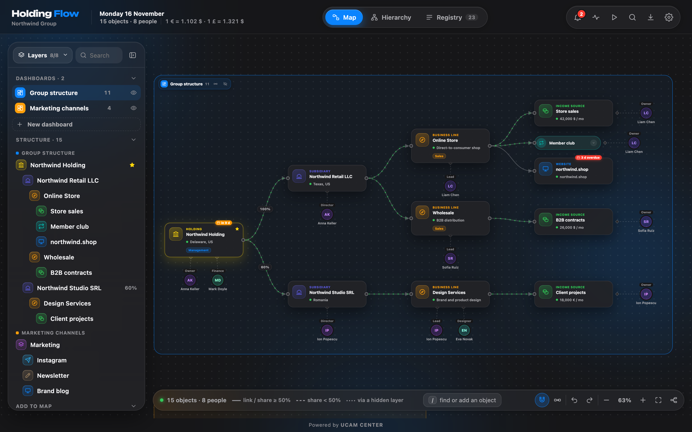
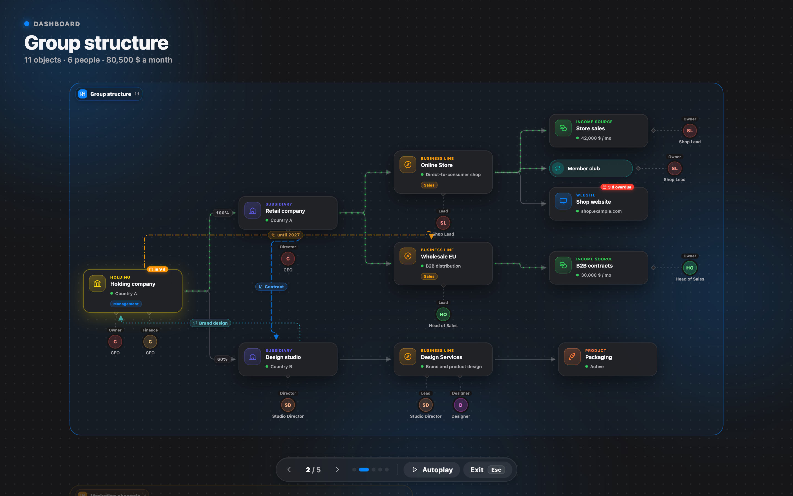
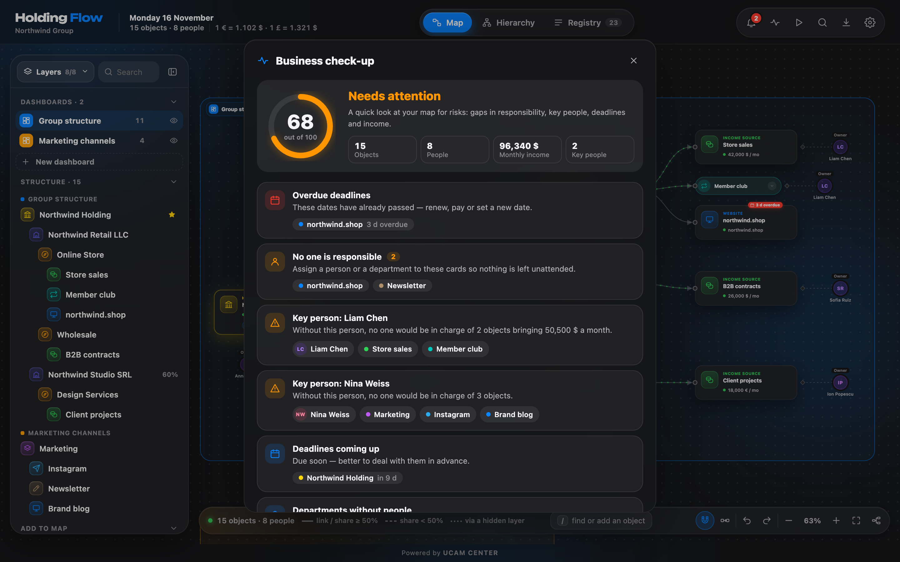
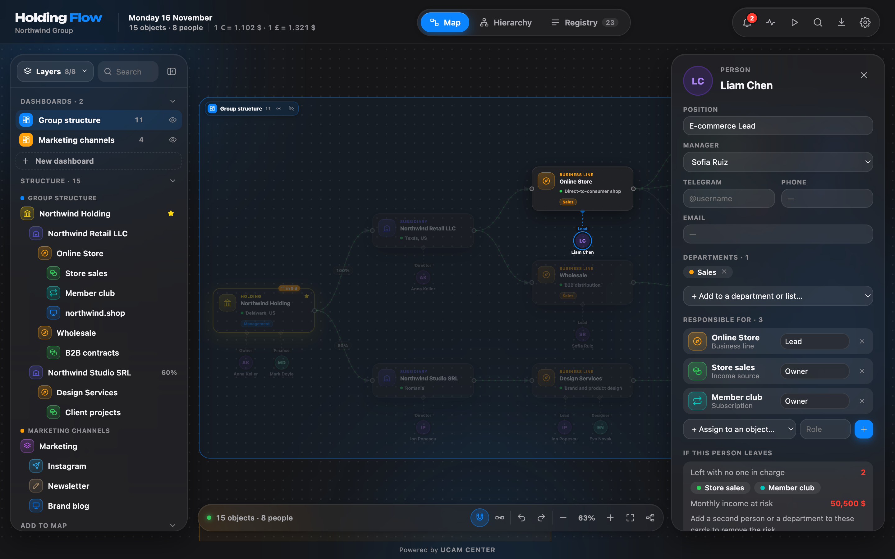
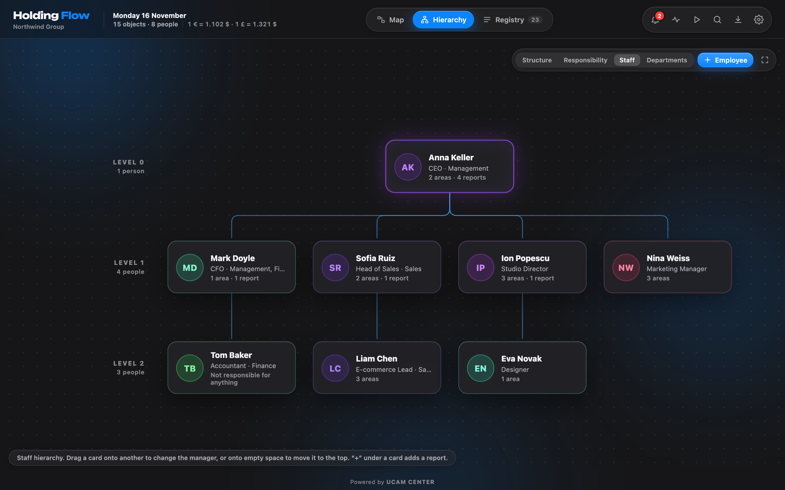
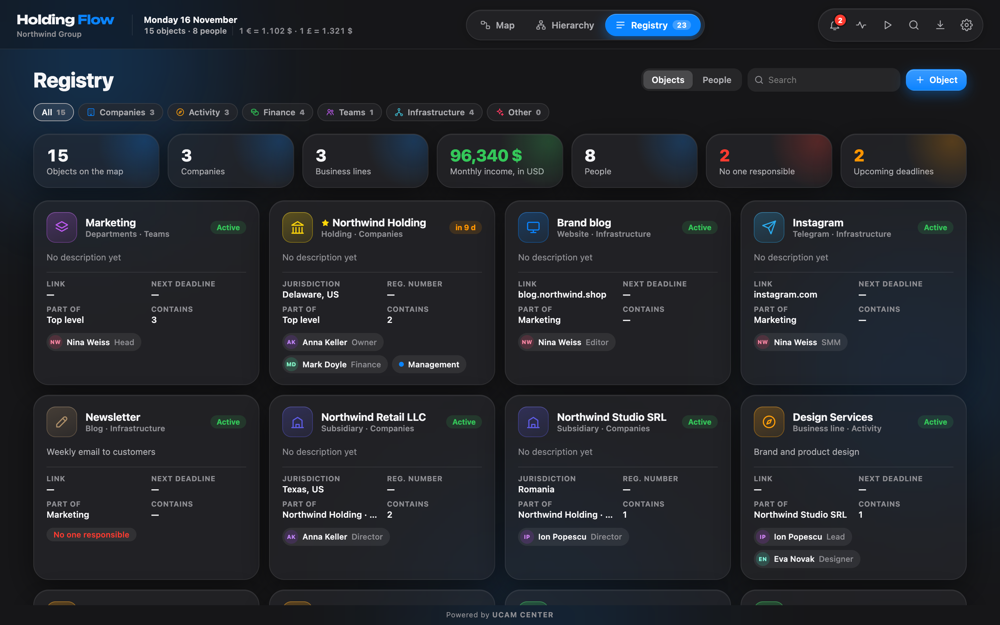

<div align="center">


# Holding Flow

**Карта бизнеса: кто где и за что отвечает.**<br>
Бесплатная программа для macOS и Windows. Ваши данные никогда не покидают компьютер.

<a href="https://github.com/ucamcenter/holding-flow-releases/releases/latest"></a> <a href="https://github.com/ucamcenter/holding-flow-releases/releases"></a> <a href="https://github.com/ucamcenter/holding-flow-releases/stargazers"></a>  <a href="https://github.com/ucamcenter/holding-flow-releases/watchers"></a>

  

<br>

<a href="https://github.com/ucamcenter/holding-flow-releases/releases/download/v1.1.0/HoldingFlow-1.1.0-mac.dmg"></a>&nbsp;<a href="https://github.com/ucamcenter/holding-flow-releases/releases/download/v1.1.0/HoldingFlow-1.1.0-windows-setup.exe"></a>

<sub><a href="https://github.com/ucamcenter/holding-flow-releases/releases">Все версии и описания релизов</a></sub>

<br>

<a href="README.md">English</a> · <a href="README.es.md">Español</a> · <a href="README.ro.md">Română</a> · <b>Русский</b>

</div>

<br>

<p align="center"></p>
<p align="center"><sub>Карта с дашбордами, ответственными и денежным потоком</sub></p>

Holding Flow собирает весь бизнес на одном холсте: холдинги и компании, направления и продукты, источники дохода и каналы продаж, команды, отделы, сайты и каналы — и людей, которые за каждое из них отвечают. Для владельцев малого и среднего бизнеса, которые держат структуру в голове и хотят наконец её увидеть.

## ✨ Что нового в 1.1.0

- **Режим презентации** — Полноэкранный показ карты для партнёров, инвесторов или команды: вся карта, каждый дашборд и его главные ветки, с плавным приближением, автопоказом и стрелками. Клавиша <kbd>P</kbd>.
- **Проверка бизнеса** — Оценка из 100 и список рисков: карточки без ответственного, ключевые люди, просроченные сроки, зависимость от одного источника дохода, отделы без людей или руководителя. Клавиша <kbd>C</kbd>.
- **«Если человек уйдёт»** — В карточке каждого человека видно, что останется без ответственного и какой месячный доход под риском.
- **Денежный поток** — Доход бежит по связям на карте — тем быстрее, чем больше денег.

## 🧩 Возможности

<table>
<tr><td width="33%" valign="top">🗺️ <b>Карта</b><br><sub>Карточки и связи, доли владения между компаниями, ответственные рядом с каждой карточкой</sub></td><td width="33%" valign="top">🧭 <b>Дашборды</b><br><sub>Несколько именованных областей на одной карте: сеть компаний, люди, денежные потоки</sub></td><td width="33%" valign="top">🏢 <b>Отделы и свои списки</b><br><sub>Люди в отделах, отделы на проектах; офисы, регионы, смены — любые свои списки</sub></td></tr>
<tr><td width="33%" valign="top">🌳 <b>Иерархия</b><br><sub>Структура, ответственность, редактируемая оргструктура и вид по отделам</sub></td><td width="33%" valign="top">📋 <b>Реестр</b><br><sub>Все объекты и люди списком: доход в месяц, сроки и пробелы</sub></td><td width="33%" valign="top">💱 <b>25 валют</b><br><sub>Ежедневные курсы для любой пары; итоги в вашей основной валюте</sub></td></tr>
<tr><td width="33%" valign="top">⏰ <b>Сроки</b><br><sub>Продление доменов, отчётность, платежи — напоминания в программе и в Telegram</sub></td><td width="33%" valign="top">📄 <b>PDF и JSON</b><br><sub>Экспорт карты, иерархий и реестров; полная резервная копия и импорт</sub></td><td width="33%" valign="top">🌍 <b>5 языков</b><br><sub>English · Español · Română · Русский · Українська; тёмная и светлая темы</sub></td></tr>
</table>

## 🖼️ Скриншоты

<table>
<tr><td width="50%" valign="top"><p align="center"><sub><b>Режим презентации</b></sub></p></td><td width="50%" valign="top"><p align="center"><sub><b>Проверка бизнеса</b></sub></p></td></tr>
<tr><td width="50%" valign="top"><p align="center"><sub><b>Если человек уйдёт</b></sub></p></td><td width="50%" valign="top"><p align="center"><sub><b>Иерархия сотрудников</b></sub></p></td></tr>
</table>

<p align="center"><br><sub><b>Реестр</b></sub></p>

## ⬇️ Скачать и установить

| Система | Файл |
|---|---|
| macOS (Apple Silicon и Intel) | [`HoldingFlow-1.1.0-mac.dmg`](https://github.com/ucamcenter/holding-flow-releases/releases/download/v1.1.0/HoldingFlow-1.1.0-mac.dmg) |
| Windows 10/11 (64-бит) | [`HoldingFlow-1.1.0-windows-setup.exe`](https://github.com/ucamcenter/holding-flow-releases/releases/download/v1.1.0/HoldingFlow-1.1.0-windows-setup.exe) |

### Первый запуск

Установщики пока не подписаны платными сертификатами Apple/Microsoft, поэтому система один раз спросит разрешение:

- **macOS:** правый клик по программе → **Открыть** → **Открыть**. Или Системные настройки → Конфиденциальность и безопасность → **Всё равно открыть**. Или в Терминале:
  ```bash
  xattr -dr com.apple.quarantine "/Applications/Holding Flow.app"
  ```
- **Windows:** в окне «Система Windows защитила ваш компьютер» нажмите **Подробнее → Выполнить в любом случае**.

Карта начинается пустой: создайте первый объект кнопками в центре экрана или нажмите <kbd>/</kbd>. Подробное руководство — в программе: Настройки → О программе → **Открыть руководство**. Там же проверка новых версий.

## 🔒 Приватность

Без аккаунта, без облака, без слежки. Всё, что вы наносите на карту, хранится только на вашем компьютере. Интернет нужен лишь для курсов валют и проверки обновлений.

## 💬 Контакты

<p><a href="https://ucam-center.com/ru/programs/"></a> <a href="mailto:support@ucam-center.com"></a> <a href="https://www.behance.net/ucamcenter"></a> <a href="https://github.com/ucamcenter"></a></p>

---

<div align="center">

Holding Flow бесплатна и продолжает обновляться.

<sub>Powered by <a href="https://ucam-center.com/ru/programs/"><b>UCAM CENTER</b></a></sub>

</div>
